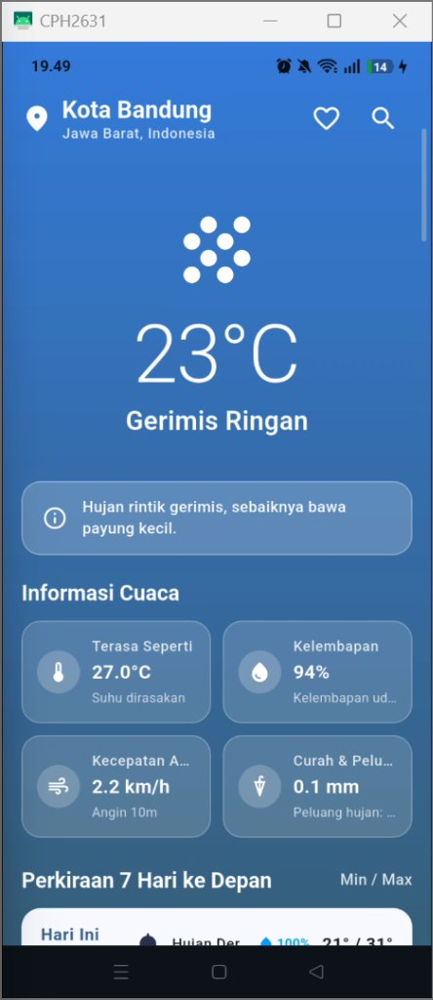
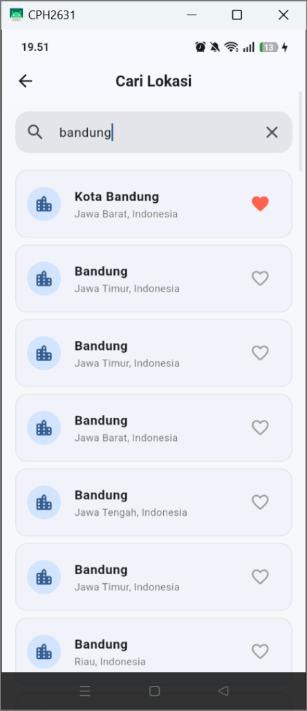

# Aplikasi Cuaca (Responsi Praktikum Pemrograman Mobile)

Proyek aplikasi ramalan cuaca berbasis **Flutter** yang dikembangkan untuk memenuhi tugas **Responsi 2 Praktikum Pemrograman Mobile**. Aplikasi ini menggunakan arsitektur **Model-View-ViewModel (MVVM)**, integrasi **REST API Open-Meteo**, dan penyimpanan data lokal persisten menggunakan **Hive**.

---

## 👤 Identitas Mahasiswa
- **Nama**: Afkar Aufaa Farros
- **NIM**: H1D024085
- **Shift**: Shift-E / Shift-C
- **Repository GitHub**: [PrakPemMob_Responsi-2_H1D024085_AfkarAufaaFarros_Shift-E_Shift-C](https://github.com/Charboros/PrakPemMob_Responsi-2_H1D024085_AfkarAufaaFarros_Shift-E_Shift-C.git)

---

## 📱 Screenshots Aplikasi

| Home / Weather Screen | Search Screen (Pencarian) | Lokasi Favorit & Riwayat |
| :---: | :---: | :---: |
|  |  |  |

> *Catatan: File gambar screenshot dapat diletakkan di dalam folder `screenshots/` dengan nama file `home_screen.png`, `search_screen.png`, dan `favorites_tab.png`.*

---

## 🌟 Fitur Utama Aplikasi

1. **Informasi Cuaca Terkini (Real-time Weather)**:
   - Menampilkan nama kota, provinsi/daerah, dan negara yang sedang dipilih.
   - Menampilkan suhu saat ini dalam derajat Celcius (`current.temperature_2m`).
   - Menampilkan kondisi cuaca terkini (berdasarkan interpretasi WMO Weather Code) lengkap dengan ikon cuaca adaptif.
   - Parameter cuaca lengkap:
     - Suhu yang dirasakan (*apparent temperature*)
     - Kelembapan relatif udara (`current.relative_humidity_2m`)
     - Kecepatan angin pada ketinggian 10 meter (`current.wind_speed_10m`)
     - Curah hujan / presipitasi (`current.precipitation`)
   - Rekomendasi/saran aktivitas harian sesuai kondisi cuaca.

2. **Perkiraan Cuaca 7 Hari ke Depan (Daily Forecast)**:
   - Menampilkan ramalan cuaca harian untuk seminggu ke depan.
   - Menampilkan suhu maksimum (`daily.temperature_2m_max`) dan minimum (`daily.temperature_2m_min`).
   - Menampilkan persentase peluang hujan harian (`daily.precipitation_probability_max`).

3. **Pencarian Kota (Geocoding API)**:
   - Pencarian kota di seluruh dunia dengan sistem *auto-debounce*.
   - Integrasi langsung ke **Open-Meteo Geocoding API**.
   - Menampilkan hasil pencarian lengkap dengan koordinat dan wilayah administrasi.
   - Pengguna dapat memilih kota untuk langsung memuat data cuaca lokasi tersebut.

4. **Penyimpanan Lokal Persisten dengan Hive**:
   - **Simpan Lokasi Favorit**: Pengguna dapat menandai kota favorit dengan satu klik tombol love/favorit.
   - **Riwayat Pencarian**: Lokasi yang pernah dibuka secara otomatis tercatat dalam riwayat pencarian.
   - **Pemulihan Lokasi Terakhir (Auto-Restore)**: Lokasi kota yang terakhir kali dibuka akan tersimpan dan langsung dimuat kembali secara otomatis saat aplikasi dibuka kembali.
   - Fitur hapus item riwayat maupun hapus seluruh riwayat sekaligus.

5. **UI & UX Modern**:
   - Desain berbasis **Material Design 3**.
   - Gradien warna latar belakang yang dinamis menyesuaikan kondisi cuaca (Cerah, Berawan, Gerimis, Hujan Lebat, Badai Petir).
   - Fitur **Pull-to-Refresh** untuk memperbarui data cuaca terkini dari server.
   - Penanganan status yang informatif: *Loading state*, *Empty state*, dan *Error state* dengan tombol *Coba Lagi*.

---

## 🏗️ Struktur Arsitektur Aplikasi (MVVM)

Aplikasi dibangun dengan pola arsitektur **Model-View-ViewModel (MVVM)** untuk memastikan kode modular, mudah diuji, dan memisahkan logika bisnis dari antarmuka pengguna:

```
lib/
├── main.dart                       # Entry point aplikasi & inisialisasi Provider + Hive
├── models/                         # [MODEL] Representasi struktur data aplikasi
│   ├── location_model.dart         # Model lokasi kota, koordinat, dan serialisasi Hive/JSON
│   ├── weather_model.dart          # Model data cuaca terkini
│   ├── daily_forecast_model.dart   # Model ramalan cuaca harian (7 hari)
│   └── weather_response_model.dart # Wrapper respon gabungan cuaca Open-Meteo
├── services/                       # [SERVICE / REPOSITORY] Akses ke sumber data eksternal & lokal
│   ├── weather_api_service.dart    # Komunikasi REST API (HTTP GET) Open-Meteo
│   └── storage_service.dart        # Database lokal Hive (Favorit, Riwayat, Lokasi Terakhir)
├── viewmodels/                     # [VIEWMODEL] Logika bisnis & manajemen state
│   ├── weather_viewmodel.dart      # State cuaca aktif, lokasi terpilih, refresh & favorit
│   └── search_viewmodel.dart       # State pencarian kota, tab favorit, dan riwayat pencarian
├── views/                          # [VIEW] Tampilan layar pengguna
│   ├── home_screen.dart            # Halaman utama informasi cuaca & ramalan harian
│   └── search_screen.dart          # Halaman pencarian kota, daftar favorit & riwayat
├── widgets/                        # Komponen UI modular
│   ├── daily_forecast_tile.dart    # Kartu baris ramalan cuaca harian
│   ├── location_list_tile.dart     # Kartu baris lokasi kota pada pencarian & riwayat
│   └── weather_detail_card.dart    # Kartu metrik parameter cuaca (kelembapan, angin, dll.)
└── utils/                          # Helper dan utilitas
    └── weather_condition_helper.dart # Pemetaan WMO Weather Code ke deskripsi, ikon & gradien
```

### Penjelasan Peran Komponen MVVM:

1. **Model**:
   - Berfungsi mendefinisikan struktur data yang diterima dari API maupun disimpan ke database lokal.
   - Contoh: `LocationModel` menyediakan fungsi `.fromGeocodingJson()`, `.toMap()`, dan `.fromMap()` untuk penyimpanan di Hive.

2. **ViewModel**:
   - Bertindak sebagai perantara antara View dan Service/Model menggunakan `ChangeNotifier` dari paket `provider`.
   - `WeatherViewModel`: Mengatur state cuaca (`WeatherViewState.loading`, `loaded`, `error`), mengambil ramalan cuaca dari `WeatherApiService`, dan mengatur lokasi aktif.
   - `SearchViewModel`: Mengatur query pencarian dengan debounce timer, memuat daftar favorit dari `StorageService`, serta mengelola riwayat pencarian.

3. **View**:
   - Membangun antarmuka visual menggunakan Flutter Widget (Stateless & Stateful).
   - Mengamati perubahan state pada ViewModel menggunakan `context.watch<T>()` atau `Consumer<T>()` dan memicu aksi melalui `context.read<T>()`.

---

## 🌐 Implementasi REST API (Open-Meteo)

Aplikasi memanfaatkan dua endpoint REST API dari Open-Meteo dengan metode HTTP GET:

### 1. Weather Forecast API
- **Endpoint**: `https://api.open-meteo.com/v1/forecast`
- **Metode**: `GET`
- **Query Parameters**:
  - `latitude`: Koordinat lintang lokasi kota.
  - `longitude`: Koordinat bujur lokasi kota.
  - `current`: `temperature_2m,relative_humidity_2m,apparent_temperature,precipitation,weather_code,wind_speed_10m`
  - `daily`: `weather_code,temperature_2m_max,temperature_2m_min,precipitation_probability_max`
  - `timezone`: `auto`

### 2. Geocoding API (Pencarian Lokasi)
- **Endpoint**: `https://geocoding-api.open-meteo.com/v1/search`
- **Metode**: `GET`
- **Query Parameters**:
  - `name`: Nama kota yang dicari.
  - `count`: `10`
  - `language`: `id`
  - `format`: `json`

### Error Handling & Jaringan:
- Menangani `SocketException` saat perangkat tidak memiliki koneksi internet.
- Menangani `TimeoutException` jika respon server melebihi batas waktu (12 detik).
- Menampilkan pesan kesalahan berbahasa Indonesia yang mudah dipahami pengguna beserta opsi tombol coba lagi (*retry*).

---

## 💾 Implementasi Local Storage (Hive)

Penyimpanan lokal diimplementasikan menggunakan **Hive** (`hive` & `hive_flutter`). Hive dipilih karena performanya yang sangat cepat, ringan, berbasis key-value NoSQL murni dalam Dart, serta tidak memerlukan konfigurasi SQLite yang rumit.

Aplikasi menggunakan 3 Box utama:
1. `favorites_box`: Menyimpan objek kota favorit yang ditandai oleh pengguna.
2. `search_history_box`: Menyimpan riwayat lokasi yang dikunjungi pengguna (maksimal 20 item terbaru).
3. `settings_box`: Menyimpan data lokasi kota terakhir yang dipilih agar saat aplikasi dibuka kembali, tampilan langsung menampilkan cuaca kota tersebut secara otomatis.

---

## 🚀 Cara Menjalankan Aplikasi

1. **Pastikan Flutter SDK sudah terpasang**:
   ```bash
   flutter --version
   ```

2. **Clone repository ini**:
   ```bash
   git clone https://github.com/Charboros/PrakPemMob_Responsi-2_H1D024085_AfkarAufaaFarros_Shift-E_Shift-C.git
   cd PrakPemMob_Responsi-2_H1D024085_AfkarAufaaFarros_Shift-E_Shift-C
   ```

3. **Unduh seluruh dependensi**:
   ```bash
   flutter pub get
   ```

4. **Jalankan pengujian unit (Unit Tests)**:
   ```bash
   flutter test
   ```

5. **Jalankan aplikasi di Emulator atau Perangkat Fisik**:
   ```bash
   flutter run
   ```

---

## 🧪 Pengujian (Testing)
Pengujian unit telah dibuat dan diverifikasi berhasil di direktori `test/widget_test.dart`, mencakup:
- Serialisasi dan deserialisasi data `LocationModel` ke/dari Hive Map.
- Parsing respon JSON `CurrentWeatherModel` dari API.
- Parsing daftar ramalan cuaca harian `DailyForecastModel`.
- Pemetaan WMO Weather Code pada `WeatherConditionHelper`.
